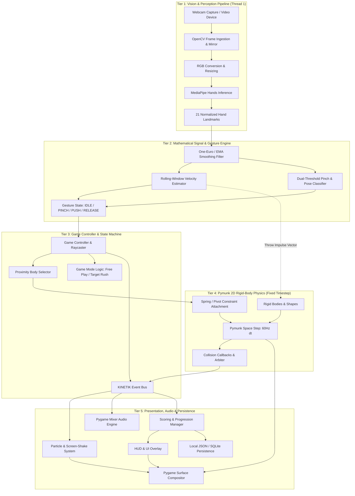
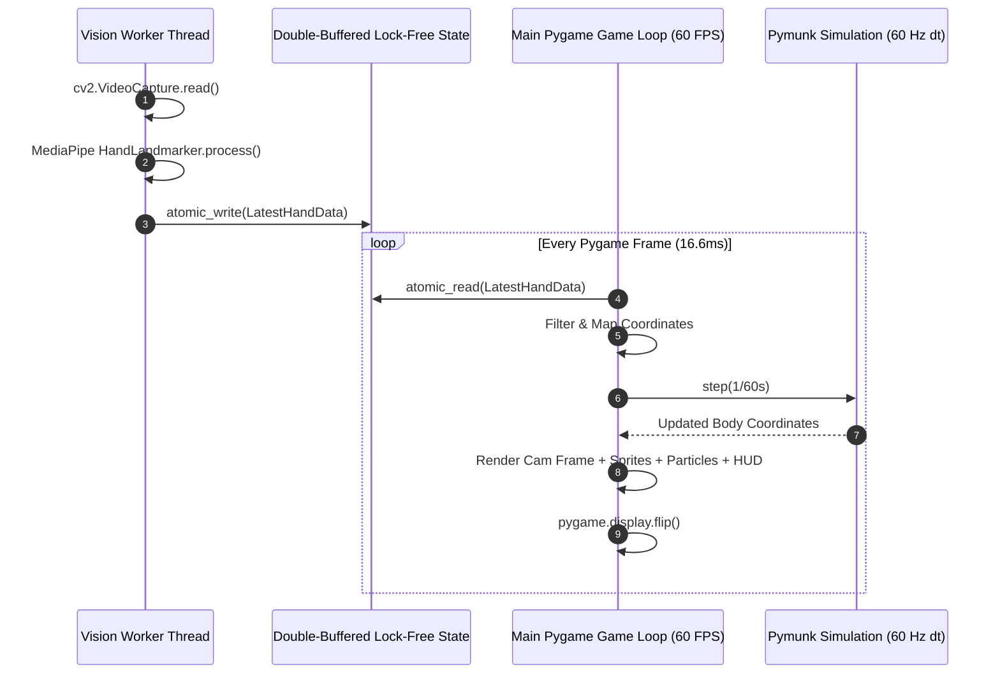
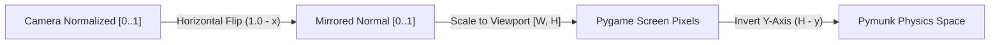
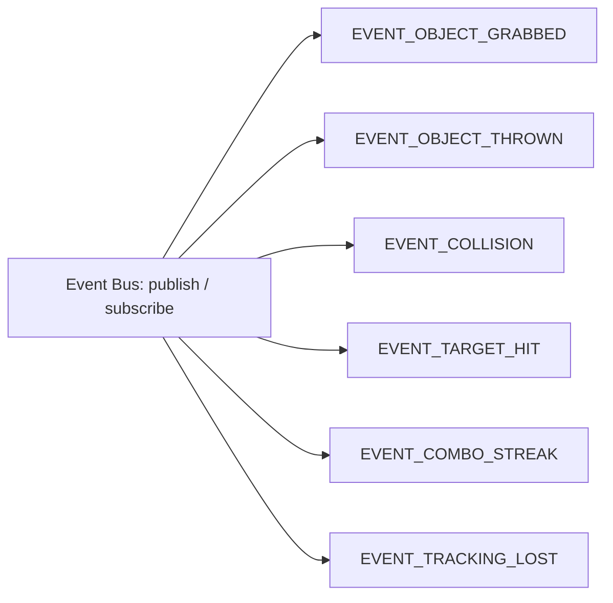

# KINETIK: System Architecture Specification

* **Document Version**: 1.0.0  
* **Architecture Type**: Real-Time Decoupled Vision-Physics Engine  
* **Target Runtime**: Python 3.12+ (CPython)  
* **Platform Support**: Windows 10/11, macOS, Linux (X11/Wayland)

---

## 1. Architectural Philosophy

KINETIK bridges high-frequency real-time computer vision with deterministic 2D rigid-body physics and interactive game rendering. The architecture is guided by three principles:

1. **Zero-Lock Decoupled Execution**: Computer vision inference (MediaPipe) must not stutter the physics simulation or visual frame rate.
2. **Explicit Coordinate Contracts**: Seamless, calibrated mathematical transformations between Camera Coordinate Space, Normalized Viewport Space, Game Screen Space, and Pymunk World Space.
3. **Reactive Event-Driven Core**: Decouple gesture classification from game rules, scoring, and particle effects using clean event dispatching.

---

## 2. Multi-Tier System Architecture



---

## 3. Threading & Latency Architecture

In standard Python game development, running heavy vision pipelines inside the Pygame render loop creates severe micro-stuttering whenever MediaPipe drops below 60 FPS. KINETIK adopts an **asynchronous worker pattern**:

### 3.1 Decoupled Threading Model



* **Thread 1: Vision Worker**:
  * Runs independently at camera hardware frame rate ($30\text{--}60\text{ FPS}$).
  * Handles OpenCV frame acquisition, color-space conversion, horizontal mirror flip, and MediaPipe inference.
  * Writes raw 21 landmark tuples into a thread-safe double buffer protected by a lightweight atomic lock.
* **Thread 2: Main Application Thread (Game Loop)**:
  * Locks to $60\text{ FPS}$ using `pygame.time.Clock.tick(60)`.
  * Reads the freshest available hand coordinates. If the camera thread has not produced a new frame, the game loop applies **extrapolation** using the last calculated velocity vector.
  * Steps physics deterministically with fixed timestep ($dt = 1/60\text{s}$).

---

## 4. Mathematical Models & Coordinate Transforms

### 4.1 Coordinate Space Transformations

1. **Camera Frame Space** $\mathbf{C} \in [0, W_{cam}] \times [0, H_{cam}]$
2. **Normalized Landmark Space** $\mathbf{L} \in [0.0, 1.0]^2$:
   MediaPipe outputs coordinates relative to camera frame dimensions.
3. **Screen Space** $\mathbf{S} \in [0, W_{screen}] \times [0, H_{screen}]$:
   $$\begin{aligned}
   x_{screen} &= (1.0 - x_{norm}) \times W_{screen} \quad \text{(Mirrored for intuitive interaction)} \\
   y_{screen} &= y_{norm} \times H_{screen}
   \end{aligned}$$
4. **Physics World Space** $\mathbf{P}$:
   Pymunk uses Cartesian coordinates (origin at bottom-left or top-left depending on mapping). For unified 2D rendering:
   $$\begin{aligned}
   x_{pymunk} &= x_{screen} \\
   y_{pymunk} &= H_{screen} - y_{screen} \quad \text{(standard Cartesian conversion)}
   \end{aligned}$$



---

### 4.2 Pinch Euclidean Distance & Dual-Threshold Hysteresis

To eliminate gesture flutter (rapid oscillating grab/drop states when fingers hover near the decision boundary), KINETIK employs a **Schmitt Trigger / Hysteresis Model**:

Let $\mathbf{P}_{thumb} = (x_4, y_4, z_4)$ and $\mathbf{P}_{index} = (x_8, y_8, z_8)$ represent the 3D landmark coordinates of the thumb and index finger tips.

The Euclidean pinch distance is:
$$d_{pinch} = \sqrt{(x_8 - x_4)^2 + (y_8 - y_4)^2 + (z_8 - z_4)^2}$$

The pinch state $S(t) \in \{\text{OPEN}, \text{PINCHED}\}$ transitions according to:

$$S(t) = \begin{cases}
\text{PINCHED} & \text{if } S(t-1) = \text{OPEN} \land d_{pinch} < \theta_{enter} \\
\text{OPEN} & \text{if } S(t-1) = \text{PINCHED} \land d_{pinch} > \theta_{exit} \\
S(t-1) & \text{otherwise}
\end{cases}$$

Where default calibrated thresholds are:
* $\theta_{enter} = 0.055$ (tight threshold to trigger grab)
* $\theta_{exit} = 0.085$ (relaxed threshold required to trigger release)
* **Debounce Window**: State transition requires persistence for at least $N = 2$ consecutive frames.

---

### 4.3 Signal Smoothing: Exponential Moving Average (EMA) & 1€ Filter

To eliminate camera sensor noise and shaky hands without introducing sluggish input latency, KINETIK supports **Adaptive Exponential Smoothing**:

$$\hat{\mathbf{P}}_t = \alpha \mathbf{P}_t + (1 - \alpha) \hat{\mathbf{P}}_{t-1}$$

Where the smoothing factor $\alpha \in [0.1, 0.9]$ adapts dynamically to the hand velocity:
$$\alpha = \alpha_{min} + (\alpha_{max} - \alpha_{min}) \times \min\left(1.0, \frac{\|\mathbf{v}\|_2}{v_{threshold}}\right)$$
* When moving slowly (aiming/holding): $\alpha \to \alpha_{min} \approx 0.25$ (ultra-smooth, zero jitter).
* When flicking/throwing: $\alpha \to \alpha_{max} \approx 0.85$ (instantaneous responsiveness, minimal lag).

---

### 4.4 Kinetic Throw Velocity Vector Estimation

When a player releases a pinch, KINETIK calculates the release velocity vector from a rolling history buffer:

$$B = \left[ (\mathbf{P}_{t-k}, \Delta t_{t-k}), \dots, (\mathbf{P}_t, \Delta t_t) \right] \quad \text{for } k \in [1, 5]$$

The release velocity vector $\mathbf{v}_{throw}$ is calculated using weighted finite backward differences:
$$\mathbf{v}_{throw} = \sum_{i=1}^{k} w_i \frac{\mathbf{P}_{t - i + 1} - \mathbf{P}_{t - i}}{\Delta t_{t - i + 1}}$$
Weights $w_i$ favor the most recent frames ($\sum w_i = 1$).

To prevent physics explosion / boundary tunneling:
$$\mathbf{v}_{applied} = \frac{\mathbf{v}_{throw}}{\max\left(1.0, \frac{\|\mathbf{v}_{throw}\|_2}{V_{clamp}}\right)} \times K_{multiplier}$$
* $V_{clamp} = 2500\text{ px/s}$
* $K_{multiplier} \in [1.0, 2.5]$ (configurable throw boost)

---

### 4.5 Physics Constraint Model (Soft Telekinetic Tether)

When an object is grabbed, KINETIK does **not** teleport the body directly to the cursor. Instead, it creates a Pymunk `DampedSpring` or `PivotJoint` between a kinematic cursor body $\mathbf{B}_{hand}$ and the target rigid body $\mathbf{B}_{target}$:

$$\mathbf{F}_{spring} = -k (\|\mathbf{x}\| - L_0) \hat{\mathbf{x}} - c (\mathbf{v}_{rel} \cdot \hat{\mathbf{x}}) \hat{\mathbf{x}}$$
* **Stiffness ($k$)**: $350.0\text{ N/m}$ (snappy yet visibly elastic)
* **Damping ($c$)**: $25.0\text{ N}\cdot\text{s/m}$ (critically damped to avoid endless oscillation)
* **Rest Length ($L_0$)**: $0.0\text{ px}$ (pulls toward hand anchor)

This gives objects natural inertia, mass resistance, and satisfying physical presence.

---

## 5. Event Bus & Decoupled Architecture

KINETIK uses a central lightweight publish-subscribe Event Bus to decouple gameplay events from presentation:



* **Audio System** listens to `COLLISION` and `THROWN` to modulate synthesized audio playback based on impact momentum.
* **Particle System** listens to `OBJECT_GRABBED` to spawn energy sparks and `COLLISION` for impact shrapnel.
* **Scoring System** listens to `TARGET_HIT` to compute multiplier bonuses and trigger combo streaks.
* **HUD** listens to all status changes to update telemetry overlays.

---

## 6. Directory Structure & Module Breakdown

```
kinetik/
├── main.py                     # Application entry point, CLI flags, lifecycle management
├── requirements.txt            # Python dependencies (opencv-python, mediapipe, pygame, pymunk, numpy)
├── pyproject.toml              # Modern Python packaging & tool configuration
├── README.md                   # Repository overview, quickstart & demo
├── LICENSE                     # MIT License
├── docs/                       # Comprehensive documentation suite
│   ├── INDEX.md                # Documentation hub
│   ├── PRD.md                  # Product Requirements Document
│   ├── ARCHITECTURE.md         # Technical architecture specification
│   ├── DEVELOPMENT_PHASES.md   # P0-P8 development phases & milestones
│   ├── FEATURES_AND_GAMIFICATION.md # Game modes, abilities & progression
│   ├── TESTING_STRATEGY.md     # Testing harnesses & verification plan
│   └── CONTRIBUTING.md         # Developer contribution guidelines
├── src/                        # Core source code
│   ├── __init__.py
│   ├── config.py               # Global constants, tuning parameters & color palettes
│   ├── events.py               # Lightweight Pub/Sub event dispatcher
│   ├── camera/
│   │   ├── __init__.py
│   │   ├── webcam.py           # Threaded OpenCV video capture manager
│   │   └── hand_tracker.py     # MediaPipe HandLandmarker wrapper & normalized output
│   ├── gestures/
│   │   ├── __init__.py
│   │   ├── detector.py         # Multi-gesture state machine (pinch, push, fist)
│   │   ├── pinch.py            # Euclidean distance & hysteresis calculation
│   │   └── motion.py           # EMA / 1€ smoothing & rolling velocity estimator
│   ├── physics/
│   │   ├── __init__.py
│   │   ├── world.py            # Pymunk Space initialization, gravity, boundaries & step
│   │   ├── objects.py          # Rigid body factories: spheres, boxes, targets, breakables
│   │   ├── constraints.py      # Damped spring & pivot telekinetic joints
│   │   └── collisions.py       # Collision handlers, arbiters & category masks
│   ├── game/
│   │   ├── __init__.py
│   │   ├── controller.py       # Central orchestrator: hands + physics + game loop
│   │   ├── modes.py            # Game mode base class & implementations (FreePlay, TargetRush)
│   │   ├── scoring.py          # Score evaluation, combo multipliers & decay timers
│   │   ├── challenges.py       # Mission objectives & condition checkers
│   │   └── progression.py      # XP, ranks, badges & achievement definitions
│   ├── rendering/
│   │   ├── __init__.py
│   │   ├── renderer.py         # Multi-layer Pygame compositor (video, objects, HUD)
│   │   ├── effects.py          # Energy tethers, glowing halos & screen-shake
│   │   ├── particles.py        # Object-pooled 2D particle simulation
│   │   └── hud.py              # Telemetry overlay, combo meters & reticles
│   ├── ui/
│   │   ├── __init__.py
│   │   ├── menu.py             # Main menu, mode selection & pause overlays
│   │   ├── settings.py         # In-game calibration & configuration screen
│   │   └── screens.py          # Game Over, victory summary & leaderboards
│   └── storage/
│       ├── __init__.py
│       ├── save_manager.py     # Local JSON save/load with atomic write
│       └── settings_store.py   # Settings persistence & fallback defaults
├── assets/                     # Game assets (synthesized audio, fonts, textures)
│   ├── sounds/                 # Telekinesis hum, grab, throw, impact wavs
│   ├── fonts/                  # Futuristic monospace & display fonts
│   └── textures/               # Particle sprites and UI icons
└── tests/                      # Automated test suite
    ├── unit/                   # Fast algorithmic & math tests
    ├── integration/            # Multi-component & physics validation tests
    └── fixtures/               # Recorded landmark frames & mock video feeds
```
