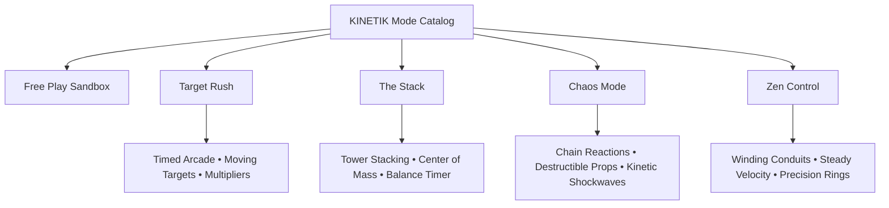
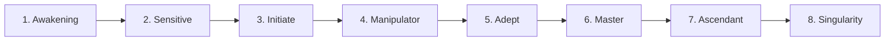

# KINETIK: Features & Gamification Specification

* **Document Version**: 1.0.0  
* **System Focus**: Game Modes, Gestural Abilities, Progression Systems & Local Economy  
* **Design Philosophy**: Reward playful experimentation, dexterity, and style over repetitive grinding; 100% offline and account-free.

---

## 1. Game Modes Architecture



### 1.1 Free Play (Sandbox Mode)
* **Goal**: Open-ended kinetic playground to experiment with physics, practice throws, and test gestural abilities.
* **Features**:
  * Dynamic object spawner (Bouncing Orbs, Heavy Crates, Frictionless Pucks, Glass Spheres).
  * Anti-gravity toggle ($g = 0$) and variable gravity slider.
  * Zero time pressure, zero penalties.
  * Real-time telemetry HUD displaying object velocity, kinetic energy, and hand coordinates.

### 1.2 Target Rush (Timed Competitive Arcade)
* **Goal**: Hit as many targets as possible within 60 seconds while sustaining a high combo multiplier.
* **Target Classes**:
  * **Standard Drone (Blue)**: Static or slow-drifting circular target ($+100\text{ pts}$).
  * **Speed Runner (Cyan)**: Fast zig-zagging target ($+250\text{ pts}$).
  * **Armored Sentry (Amber)**: Requires two high-momentum hits or a heavy block impact ($+500\text{ pts}$).
  * **Golden Snitch (Gold)**: Spawns briefly for $4\text{ seconds}$; rewards $+1000\text{ pts}$ and adds $+5\text{ seconds}$ to the round clock.
  * **Hazard Mine (Red)**: Accidental impact deducts $-300\text{ pts}$ and instantly breaks the combo streak.

### 1.3 The Stack (Physics Balancing)
* **Goal**: Build and balance a tower of geometric blocks past designated height thresholds.
* **Rules**:
  * Physics blocks of varying geometry (cubes, planks, trapezoids) spawn one at a time.
  * Player carefully grabs and stacks blocks.
  * The tower must remain balanced above each checkpoint line for $5.0\text{ seconds}$ to trigger the next tier.
  * Wind disturbances and micro-tremors increase challenge at higher tiers.

### 1.4 Chaos Mode (Chain Reaction Destruction)
* **Goal**: Trigger maximum kinetic energy chain reactions using explosive canisters, falling dominoes, and shattering barriers.
* **Scoring**: Points awarded proportional to total impulse ($\sum \|\mathbf{J}\|$), shattered shards, and simultaneous cascade events.

### 1.5 Zen Control (Steadiness & Trajectory Precision)
* **Goal**: Guide a delicate telekinetic orb through narrow, winding energy conduits without letting the orb touch electric boundary walls.
* **Mechanic**: Tests micro-movement smoothing; moving too fast destabilizes the orb's containment field.

---

## 2. Gestural Abilities & Telekinetic Powers

| Ability | Hand Gesture | Mechanical Action | Energy / Visual Feedback |
| :--- | :--- | :--- | :--- |
| **Kinetic Grab** | Pinch (Thumb + Index) | Locks onto nearest object within selection radius; binds via damped spring constraint. | Cyan focal ring contracts; electrical beam links fingers to object. |
| **Kinetic Throw** | Release Pinch with Velocity | Transfers accumulated momentum vector to object; clamps max velocity. | Kinetic blur ribbon trail; high-velocity whoosh audio. |
| **Force Push** | Open Palm Forward Thrust | Emits conical shockwave pushing all nearby unheld dynamic bodies. | Radial distortion shockwave ripple; heavy bass boom. |
| **Object Crush** | Closed Fist while Holding | Crushes a held fragile object into high-speed shrapnel projectiles. | Energy implosion followed by sharp particle fragmentation. |
| **Stasis Hover** | Two-Finger Pose (Peace / V) | Locks target object in zero-gravity stasis at its current screen coordinate. | Violet crystalline ring encases object; hums steadily. |
| **Precision Reticle** | Index Finger Pointing | Projects high-precision laser crosshair for long-range targeting. | Focused laser line with distance tick marks. |

---

## 3. Scoring & Combo System

### 3.1 Scoring Algorithm
Total points for an impact event are computed as:

$$\text{Points} = (\text{BasePoints} \times M_{combo}) + B_{velocity} + B_{trick}$$

Where:
* $\text{BasePoints}$: Target point value ($100\text{--}1000$).
* $M_{combo}$: Current combo multiplier ($1.0\times, 1.5\times, 2.0\times, 2.5\times, 3.0\times, 4.0\times, 5.0\times$).
* $B_{velocity}$: High-speed bonus: $\lfloor \frac{\|\mathbf{v}_{impact}\|}{100} \rfloor \times 20$.
* $B_{trick}$: Trick shot bonus:
  * **Bank Shot**: Object ricochets off a boundary wall before hitting target ($+150\text{ pts}$).
  * **Double Hit**: Single throw breaks two targets in succession ($+300\text{ pts}$).
  * **Air Snatch**: Catching an object mid-air before it hits the ground ($+200\text{ pts}$).

### 3.2 Combo Decay Mechanics
* Each successful target hit extends the combo timer to $3.5\text{ seconds}$.
* A circular decay gauge around the HUD combo indicator drains over time.
* If the decay timer expires without a hit, the multiplier drops by 1 tier (e.g., $3.0\times \to 2.5\times$) rather than instantly resetting to $1.0\times$, preserving player momentum.
* Hitting a Hazard Mine instantly resets the combo to $1.0\times$.

---

## 4. Telekinetic Progression & Rank Hierarchy

Players earn Telekinetic XP ($XP$) from every match. Progression is strictly skill-and-dexterity-based.

$$\text{XP Earned} = \lfloor \frac{\text{Final Score}}{10} \rfloor + \text{Bonus}_{accuracy} + \text{Bonus}_{challenges}$$

### 4.1 Telekinetic Ranks



| Rank | Title | Cumulative XP | Rank Unlock Perk |
| :---: | :--- | :---: | :--- |
| **I** | **Awakening** | $0$ | Default Free Play & Target Rush access. |
| **II** | **Sensitive** | $1,500$ | Unlock **Violet Flux** energy tether theme. |
| **III** | **Initiate** | $4,500$ | Unlock **The Stack** game mode + Tungsten heavy block. |
| **IV** | **Manipulator** | $10,000$ | Unlock **Force Push** shockwave ability. |
| **V** | **Adept** | $20,000$ | Unlock **Emerald Matrix** tether + **Chaos Mode**. |
| **VI** | **Master** | $35,000$ | Unlock **Stasis Hover** ability + Antimatter prop. |
| **VII** | **Ascendant** | $60,000$ | Unlock **Solar Flare** golden particle trails + **Zen Control**. |
| **VIII** | **Singularity** | $100,000$ | Cosmic Black Hole tether effect + "The Mind Unleashed" title. |

---

## 5. Unlockables & Cosmetics Catalog

All cosmetics are unlocked strictly through gameplay milestones and persisted locally:

### 5.1 Energy Tether Themes
* **Neon Cyan** *(Default)*: Classic electric cyan beam with subtle sine vibration.
* **Violet Flux** *(Rank II)*: Deep purple lightning tether with arc sparks.
* **Emerald Matrix** *(Rank V)*: Green data-stream laser tether.
* **Solar Flare** *(Rank VII)*: Radiant gold corona with fiery plasma particles.
* **Glitch Void** *(Achievement Unlocked)*: Shifting chromatic aberration tether.

### 5.2 Physics Object Skins
* **Standard Matte Sphere**: Clean minimalist shaded ball.
* **Tungsten Core**: High-density metallic ball with reflective chrome sheen and heavy mass.
* **Glass Prism**: Breakable crystal sphere that refracts background camera pixels.
* **Antimatter Fragment**: Glowing pulsing core that repels background particles.

---

## 6. Achievements Specification

| ID | Title | Condition | Reward Badge |
| :--- | :--- | :--- | :--- |
| `ACH_FIRST_FLING` | **First Spark** | Perform your very first telekinetic throw in any mode. | 🥉 Bronze Badge |
| `ACH_SHARPSHOOTER` | **Kinetic Marksman** | Achieve $85\%+$ accuracy in Target Rush with at least 15 hits. | 🥈 Silver Badge |
| `ACH_COMBO_KING` | **Flow State** | Reach and sustain a $5.0\times$ combo for $15\text{ seconds}$. | 🥇 Gold Badge |
| `ACH_SPEED_DEMON` | **Mach Fling** | Throw an object exceeding $2000\text{ px/s}$ release velocity. | ⚡ Lightning Badge |
| `ACH_TOWER_GOD` | **Defying Newton** | Balance an 8-block tower in The Stack for 10 seconds. | 🏛️ Platinum Badge |
| `ACH_ZEN_MASTER` | **Untouchable** | Complete a Zen Control stage without touching a single boundary. | ☯️ Diamond Badge |

---

## 7. Local Save Schema (`save.json`)

All player data is stored locally in human-readable JSON at `~/.kinetik/save.json` or within `./storage/save.json`:

```json
{
  "version": "1.0.0",
  "player": {
    "nickname": "TelekineticMaster",
    "total_xp": 14250,
    "current_rank": "Manipulator",
    "playtime_seconds": 3840
  },
  "high_scores": {
    "target_rush": {
      "best_score": 18450,
      "max_combo": 5.0,
      "date": "2026-11-23T15:42:00Z"
    },
    "the_stack": {
      "max_height_tier": 6,
      "date": "2026-11-22T19:10:00Z"
    },
    "chaos_mode": {
      "max_cascade_points": 42100,
      "date": "2026-11-21T21:05:00Z"
    }
  },
  "unlocked_items": [
    "tether_cyan",
    "tether_violet",
    "prop_tungsten",
    "ability_force_push"
  ],
  "equipped_cosmetics": {
    "tether_theme": "tether_violet",
    "default_prop": "prop_tungsten"
  },
  "achievements": {
    "ACH_FIRST_FLING": { "unlocked": true, "timestamp": "2026-11-20T10:00:00Z" },
    "ACH_SHARPSHOOTER": { "unlocked": true, "timestamp": "2026-11-21T14:30:00Z" },
    "ACH_COMBO_KING": { "unlocked": false, "progress": 0.6 }
  },
  "settings": {
    "camera_index": 0,
    "mirror_camera": true,
    "camera_resolution": [640, 480],
    "smoothing_factor": 0.65,
    "throw_force_multiplier": 1.4,
    "reduced_motion": false,
    "audio_master_volume": 0.8
  }
}
```
