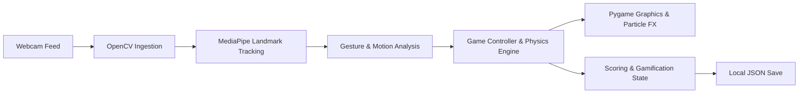

# KINETIK Documentation Hub

Welcome to the technical and product documentation for **KINETIK** — an open-source, webcam-powered telekinesis playground that turns an ordinary camera into a hands-free physics controller.

---

## 🧭 Documentation Index

| Document | Purpose & Contents |
| :--- | :--- |
| **[PRD (Product Requirements Document)](./PRD.md)** | Product vision, target audience, non-goals, core user stories, functional requirements (`FR-01` to `FR-14`), and product north star. |
| **[Architecture Specification](./ARCHITECTURE.md)** | Multi-tier software architecture, real-time pipeline, thread decoupling model, coordinate mapping transforms, gesture recognition algorithms, physics integration, and module specifications. |
| **[Development Phases & Roadmap](./DEVELOPMENT_PHASES.md)** | Phases `P0` through `P8` execution plan, deliverables, acceptance criteria, v0.1 first-build checklist, risk mitigations, and definition of done. |
| **[Features & Gamification System](./FEATURES_AND_GAMIFICATION.md)** | Complete specification of game modes (Free Play, Target Rush, The Stack, Chaos, Zen), gesture abilities, XP math, rank progression (`Awakening` $\to$ `Singularity`), combo multipliers, challenges, unlocks, and local JSON/SQLite schemas. |
| **[Testing & QA Strategy](./TESTING_STRATEGY.md)** | Comprehensive testing matrix: headless computer-vision test harnesses, gesture synthetic fixtures, deterministic physics simulations, latency/FPS profiling, and accessibility checks. |
| **[Contribution Guide](./CONTRIBUTING.md)** | Open-source developer guide, coding conventions, branch & PR strategy, development setup, and Architecture Decision Record (ADR) template. |

---

## ⚡ Project Overview at a Glance

* **Tagline**: *Control reality with your hands.*
* **Product Type**: Desktop, camera-based gesture-controlled 2D physics playground.
* **Core Technology Stack**:
  * **Language & Orchestration**: Python 3.12+
  * **Computer Vision**: OpenCV (`cv2`)
  * **Hand Landmark Inference**: Google MediaPipe
  * **Physics Engine**: Pymunk (Chipmunk2D C wrapper)
  * **Windowing, Rendering & Audio**: Pygame (SDL2)
  * **Math & Signal Filtering**: NumPy
  * **State & Persistence**: Local JSON / SQLite
* **Philosophy**:
  * **100% Local-First & Zero-Telemetry**: No account required, zero cloud inference, no telemetry, complete user privacy.
  * **Game-Feel Centered**: Physics lag, spring constraints, hysteresis thresholds, energy tethers, and visual punchiness prioritize delight over rigid scientific simulation.
  * **Extensible & Moddable**: Modular engine design separating vision acquisition, gesture classification, physics simulation, and rendering pipelines.

---

## 📐 High-Level Interaction Flow

