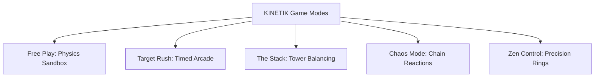

# KINETIK: Product Requirements Document (PRD)

* **Document Version**: 1.0.0  
* **Product Name**: KINETIK  
* **Product Type**: Desktop, webcam-powered gesture-controlled 2D physics game  
* **License**: MIT (100% Open Source)  
* **Release Target**: Local-First Desktop (Windows primary; cross-platform Linux / macOS compatibility)

---

## 1. Executive Summary

**KINETIK** turns an ordinary computer webcam into a magical hands-free controller. Using cutting-edge hand tracking and low-latency computer vision, players manipulate virtual physics objects directly with their bare hands as if wielding telekinetic abilities.

The project prioritizes **responsive controls, satisfying physics, juicy visual feedback, and playful experimentation** over pure realism or enterprise utility. The first milestone proves and perfects a tactile core interaction loop:

$$\text{Detect Hand} \longrightarrow \text{Pinch to Grab} \longrightarrow \text{Move Naturally} \longrightarrow \text{Flick to Throw} \longrightarrow \text{Impact \& Collide}$$

Once that interaction loop feels responsive and fun, KINETIK expands into structured game modes, combo-based scoring systems, challenge objectives, and rich local progression.

> **Product Principle**: *Make the interaction feel magical before making the game large.*

---

## 2. Product North Star & Vision

### Vision
To make anyone sitting in front of a computer feel like they possess genuine telekinetic superpowers using nothing more than standard consumer hardware.

### Product North Star
> *"The player should forget they are using a webcam and feel like they are controlling the objects directly with their mind and hands."*

A build is considered complete and release-ready when a user can launch the application, detect their hand within 5 seconds, grasp an object with an intuitive pinch, fling it across the screen with kinetic momentum, smash target obstacles, and complete a bite-sized challenge without touching a keyboard or mouse, requiring zero calibration friction or cloud accounts.

---

## 3. Goals & Non-Goals

### 3.1 Primary Goals
1. **Immediate Playability**: Zero mandatory calibration or setup hurdles. Launch and start playing inside 60 seconds.
2. **Stable, Flicker-Free Control**: Rigorous hysteresis and motion filtering preventing accidental drops, jittery cursors, or spurious releases.
3. **100% Local-First & Private**: No cloud computation, zero telemetry, no user accounts or API keys required.
4. **Juicy Game Feel**: Spring-damper constraint physics, luminous particle tethers, screen shakes, dynamic sound cues, and velocity inertia.
5. **Clean, Extensible Open-Source Architecture**: Strict modularity enabling contributors to add new game modes, gesture abilities, physics props, and custom visual skins.

### 3.2 Non-Goals (v1.0 Scope Boundaries)
* **No Photorealistic 3D Graphics / Spatial Occlusion**: KINETIK is purposefully designed around crisp, stylized 2D physics rendered over the mirrored live webcam feed or minimalist backdrop.
* **No Online Multiplayer or Cloud Leaderboards**: Focus is entirely on single-player flow and local couch challenges.
* **No Custom Neural Network Training**: Relies on standardized, battle-tested ML models (MediaPipe Hand Landmarker).
* **No Complex Menus or Pay-to-Win Mechanics**: All unlocks, ranks, and achievements are earned through gameplay and saved locally in plain JSON.
* **No Native Mobile App in Initial Milestones**: Optimized exclusively for desktop laptop and monitor webcams.

---

## 4. Target Users & Use Cases

### 4.1 Target Personas
* **Creative Tech Enthusiasts & Gamers**: Looking for novel, playful interactions that showcase the frontier of computer vision and human-computer interaction (HCI).
* **Developers & Open-Source Tinkerers**: Developers who want to examine clean Python architectures combining OpenCV, MediaPipe, Pygame, and Pymunk.
* **Streamers & Content Creators**: Creators who want eye-catching, highly visual camera-driven content for short-form clips (TikTok, YouTube Shorts) and live streams.

### 4.2 Core Use Cases
* **Freeform Sandboxing**: Unwinding by throwing, stacking, and smashing physics blocks with hand flicks.
* **Skill & Precision Practice**: Guiding high-speed or fragile kinetic spheres through narrow obstacle rings and target goals.
* **Local Arcade Competition**: Passing the webcam between friends to beat highest Target Rush scores and maintain combo chains.

---

## 5. Functional Requirements Matrix

| ID | Module / Area | Detailed Requirement | Priority |
| :--- | :--- | :--- | :--- |
| **FR-01** | Camera Engine | Capture video from selected webcam; support standard resolutions ($640\times 480$ default, $1280\times 720$ toggle); handle device disconnects gracefully; provide instantaneous horizontal flip (mirror mode). | **P0 (Must)** |
| **FR-02** | Hand Tracking | Process frames using MediaPipe; extract 21 3D hand landmarks per hand; provide confidence scoring and handedness (Left/Right); support at least one active hand with low latency. | **P0 (Must)** |
| **FR-03** | Gesture Detection | Compute Euclidean distance between Thumb Tip (ID 4) and Index Tip (ID 8); implement dual-threshold hysteresis (`PINCH_START_DIST` vs `PINCH_RELEASE_DIST`) and debounce window (minimum frames) to eliminate rapid flickering. | **P0 (Must)** |
| **FR-04** | Coordinate Mapping | Transform normalized $[0.0, 1.0]$ camera landmark space into Pygame screen space $[W, H]$; support configurable active interaction bounding box and adjustable sensitivity/deadzones. | **P0 (Must)** |
| **FR-05** | Object Selection | When a pinch starts, find the nearest physics body within interaction radius ($R_{select}$); compute ray/proximity; highlight and lock target body. | **P0 (Must)** |
| **FR-06** | Telekinetic Grab | Attach selected body to the hand anchor point using a Pymunk Damped Spring / Pivot constraint so the object lags naturally with mass and inertia rather than unnaturally snapping/teleporting. | **P0 (Must)** |
| **FR-07** | Kinetic Throw | Continuously buffer recent hand positions over a rolling window ($N \approx 5$ frames); compute moving average velocity vector on pinch release; impart impulse to body; clamp maximum velocity to avoid physics tunneling. | **P0 (Must)** |
| **FR-08** | Kinetic Push | Detect rapid palm forward velocity or open-palm expansion towards camera; cast impulse cone/shockwave that repels nearby dynamic bodies with dedicated cooldown. | **P1 (Should)** |
| **FR-09** | 2D Physics World | Construct Pymunk space with gravitational vector, boundary walls, collision filtering categories, friction, and restitution coefficients. | **P0 (Must)** |
| **FR-10** | Spawner & Controls | Provide keyboard fallbacks (`R` to reset, `Space` to spawn balls/cubes, `M` to mute, `Esc` to pause/exit) and on-screen gesture touchpoints. | **P0 (Must)** |
| **FR-11** | Minimalist HUD | Overlay real-time FPS counter, tracking confidence indicator, current gesture state, selected target info, and active combo score. | **P0 (Must)** |
| **FR-12** | Settings & Tuning | Allow real-time tuning of camera index, mirror mode, smoothing factors ($\alpha$), throw multiplier, spring stiffness, and particle intensity. | **P1 (Should)** |
| **FR-13** | Local Persistence | Serialize high scores, user preferences, and unlocked badges to local JSON (`~/.kinetik/save.json` or `./storage/save.json`). | **P1 (Should)** |
| **FR-14** | Error Recovery | Gracefully handle camera disconnects, temporary hand occlusion/tracking dropouts (grace period before dropping held object), and window resizing. | **P0 (Must)** |

---

## 6. Game Modes Scope

### 6.1 Mode Breakdown

1. **Free Play (MVP Foundation)**:
   * Unlimited sandbox: dynamic spawners, anti-gravity zones, breakable crates, bouncing spheres.
   * Player experiments with grab, throw, push, and dual-hand interactions.
2. **Target Rush (First Structured Game Mode)**:
   * $60$-second round timer.
   * Targets spawn across the screen with varying point values, movement patterns, and sizes.
   * Hitting targets without missing builds a **Combo Multiplier** ($1\times \to 5\times$).
3. **The Stack (Secondary)**:
   * Stack irregularly shaped geometric blocks. Keep the tower stable above target thresholds for $N$ seconds under shifting physics impulses.
4. **Chaos Mode (Experimental)**:
   * Dominoes, explosive barrels, tethered wrecking balls, and shattering glass panels. Maximizes screen shake and particle simulation.
5. **Zen Control (Precision)**:
   * Move fragile orbs through winding energy conduits without touching boundaries. Tests micro-smoothing and steadiness.

---

## 7. User Experience & Game Feel Specifications

* **Visual Theme**: Cyberpunk / Synthwave Minimalist Control Room.
  * Palette: Deep Obsidian background (`#0B0D13`), Neon Cyan energy arcs (`#00F0FF`), Radiant Violet highlights (`#9D00FF`), Amber warnings (`#FFB800`).
* **Visual Juice Checklist**:
  * **Pinch Formation**: Glowing focal ring contracts between index and thumb landmarks.
  * **Object Held**: Luminous bezier energy tether connects hand anchor to object center-of-mass with sine-wave lightning vibration.
  * **Kinetic Throw**: Motion blur ribbon trails behind thrown object; color scales with velocity magnitude.
  * **Impact**: Radial particle burst + micro screen-shake ($2-6\text{px}$ displacement damped over 150ms) + dynamic audio pitch scaling based on impact energy.
* **Accessibility & Ergonomics**:
  * Interaction zones mapped to natural mid-chest hand height to avoid shoulder fatigue (the "gorilla arm" effect).
  * Reduced motion / flashing toggle in settings.
  * Full keyboard and mouse fallbacks for testing and accessibility.

---

## 8. Success Metrics

1. **Time-to-First-Fling (TTFF)**: $\le 90\text{ seconds}$ from cloning/launching to successfully throwing an object.
2. **Gesture Reliability**: $\ge 98\%$ pinch stability in consistent home lighting without involuntary object drops.
3. **Frame Budget**: Sustained $\ge 30\text{ FPS}$ on standard integrated GPUs (e.g. Intel Iris Xe) and $\ge 60\text{ FPS}$ on discrete GPUs.
4. **Delight & Engagement**: Playtesters naturally string multiple throws together and attempt creative trick shots.
