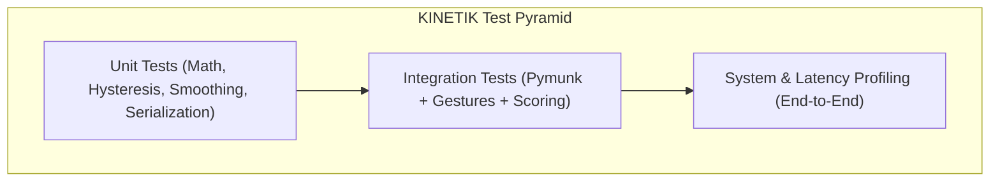
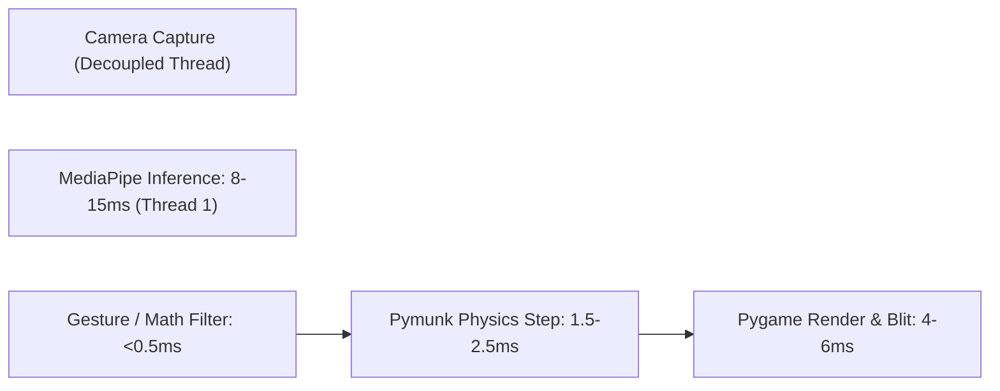

# KINETIK: Testing & Quality Assurance Strategy

* **Document Version**: 1.0.0  
* **Test Philosophy**: Automated headless verification, deterministic physics simulation, and zero-webcam CI testability.  
* **Testing Framework**: `pytest`, `pytest-benchmark`, `unittest.mock`

---

## 1. Testing Philosophy & Pyramid

Computer vision and physics games often suffer from "manual-only" testing because developers assume a physical camera and hand are required to test anything. In KINETIK, **every algorithmic, mathematical, and physics component is 100% decoupled and testable in headless CI pipelines without a webcam connected.**



---

## 2. Test Architecture & Mocking Strategy

### 2.1 The Headless Vision Fixture (`MockWebcam` & `SyntheticHand`)

To enable instant automated testing on GitHub Actions or developer laptops without camera hardware, KINETIK uses a synthetic landmark injection harness:

```python
# Conceptual synthetic test fixture
class SyntheticHandGenerator:
    """Generates synthetic 21-landmark hand vectors for automated tests."""
    
    @staticmethod
    def create_open_hand(anchor_x=0.5, anchor_y=0.5):
        """Returns landmark dictionary representing an open palm."""
        landmarks = {i: [anchor_x, anchor_y, 0.0] for i in range(21)}
        landmarks[4] = [anchor_x - 0.1, anchor_y, 0.0]  # Thumb tip
        landmarks[8] = [anchor_x + 0.1, anchor_y, 0.0]  # Index tip
        return landmarks

    @staticmethod
    def create_pinched_hand(anchor_x=0.5, anchor_y=0.5):
        """Returns landmark dictionary representing a closed pinch."""
        landmarks = {i: [anchor_x, anchor_y, 0.0] for i in range(21)}
        landmarks[4] = [anchor_x, anchor_y, 0.0]        # Thumb tip
        landmarks[8] = [anchor_x + 0.02, anchor_y, 0.0] # Index tip (dist = 0.02)
        return landmarks
```

---

## 3. Test Categories & Scope

### 3.1 Unit Testing (Algorithmic & Pure Logic)

| Test Suite | File Location | Key Invariants Verified |
| :--- | :--- | :--- |
| **Pinch Hysteresis** | `tests/unit/test_pinch.py` | State does not enter `PINCH` until distance $< 0.055$; state does not exit `PINCH` until distance $> 0.085$; intermediate values preserve prior state. |
| **Debounce Window** | `tests/unit/test_pinch.py` | Single-frame outlier anomalies (glitches) are ignored; state transitions require $N \ge 2$ consecutive frames. |
| **Signal Smoothing** | `tests/unit/test_motion.py` | Verify EMA and 1€ filters eliminate Gaussian jitter on static inputs while retaining responsiveness under sudden velocity spikes. |
| **Coordinate Transform** | `tests/unit/test_coords.py` | Normalized $[0..1]$ coordinates correctly map to Pygame screen coordinates with horizontal mirroring and aspect-ratio preservation. |
| **Velocity Estimator** | `tests/unit/test_velocity.py` | Moving average backward differences accurately compute velocity vector; verify velocity clamping limits output $\le V_{clamp}$. |
| **Save Serialization** | `tests/unit/test_storage.py` | Atomic writes ensure corrupt or interrupted saves fallback to clean backups without data loss. |

---

### 3.2 Physics Integration Testing (Headless Pymunk)

| Test Suite | File Location | Key Invariants Verified |
| :--- | :--- | :--- |
| **Boundary Confinement** | `tests/integration/test_physics_world.py` | Rigid bodies spawned inside world space never penetrate or escape boundary segments even under high velocity. |
| **Telekinetic Joint** | `tests/integration/test_constraints.py` | Verify that attaching a body to a moving hand kinematic anchor via `DampedSpring` produces smooth restorative forces without NaN/infinite velocities. |
| **Impulse Release** | `tests/integration/test_throw.py` | On pinch release, verify target body inherits momentum matching the release velocity vector. |
| **Collision Arbiter** | `tests/integration/test_collisions.py` | Collision between projectile and target generates correct `COLLISION` event with kinetic energy proportional to relative velocities. |

---

### 3.3 Scoring & Gamification Rules Testing

| Test Suite | File Location | Key Invariants Verified |
| :--- | :--- | :--- |
| **Combo Multiplier** | `tests/unit/test_scoring.py` | Consecutive hits step multiplier ($1\times \to 1.5\times \dots \to 5.0\times$); decay timer countdown decrements multiplier tier cleanly. |
| **XP Calculation** | `tests/unit/test_progression.py` | Accurate XP math according to base points, accuracy, and trick shot bonuses. |
| **Rank Transitions** | `tests/unit/test_progression.py` | Crossing cumulative XP thresholds triggers correct rank promotions and unlocks corresponding cosmetic assets. |

---

## 4. Performance & Latency Benchmarks

KINETIK targets sustained real-time performance on consumer laptops. The automated benchmark suite measures:

### 4.1 Latency Budget Matrix ($60\text{ FPS} \approx 16.6\text{ms}$ budget)



### 4.2 Benchmark Commands
```bash
# Run pytest benchmarks with summary
pytest tests/benchmarks/ --benchmark-only --benchmark-columns=min,mean,max,stddev
```

* **Pass Criteria**:
  * Pymunk physics step with 50 active bodies: $\le 2.5\text{ms}$.
  * Gesture state classifier & smoothing step: $\le 0.4\text{ms}$.
  * Coordinate mapping & boundary raycasts: $\le 0.2\text{ms}$.
  * Memory footprint remains stable over $10,000$ simulated steps (zero unbounded particle leak).

---

## 5. Edge Case & Chaos Matrix

| Edge Case Scenario | Test Injection Method | Expected System Behavior |
| :--- | :--- | :--- |
| **Sudden Camera Disconnect** | Mock camera raising `cv2.error` or returning `None` frames mid-game. | Game catches exception, displays on-screen "Camera Disconnected" banner, freezes physics clock, safely releases held objects. |
| **Brief Hand Tracking Loss** | Suppress landmark detection for $1\text{--}8$ frames while holding an object. | $300\text{ms}$ grace period activates: held object maintains hovering stasis rather than violently dropping. |
| **Ludicrous Throw Velocity** | Feed synthetic hand coordinate jumping $500\text{px}$ in 1 frame. | Velocity clamping enforces $V_{clamp} = 2500\text{px/s}$; prevents tunneling through boundary walls. |
| **Corrupt Local Save File** | Corrupt `save.json` with malformed syntax. | System catches `json.JSONDecodeError`, archives corrupted file to `save.json.bak`, initializes fresh default profile, and alerts user. |
| **Rapid Pinch Thrashing** | Toggle pinch state on every alternating frame ($0, 1, 0, 1$). | Debounce window filters alternating noise; state remains stable without audio/constraint thrashing. |

---

## 6. Continuous Integration (CI) Automation

GitHub Actions workflow configuration (`.github/workflows/ci.yml`):

```yaml
name: KINETIK CI

on: [push, pull_request]

jobs:
  test:
    runs-on: ${{ matrix.os }}
    strategy:
      matrix:
        os: [ubuntu-latest, windows-latest, macos-latest]
        python-version: ["3.12"]

    steps:
      - uses: actions/checkout@v4
      - name: Set up Python
        uses: actions/setup-python@v5
        with:
          python-version: ${{ matrix.python-version }}
      - name: Install Dependencies
        run: |
          python -m pip install --upgrade pip
          pip install -r requirements.txt
          pip install pytest pytest-cov pytest-benchmark
      - name: Run Headless Tests
        env:
          SDL_VIDEODRIVER: "dummy"
          SDL_AUDIODRIVER: "dummy"
        run: |
          pytest tests/ --cov=src --cov-report=term-missing
```
